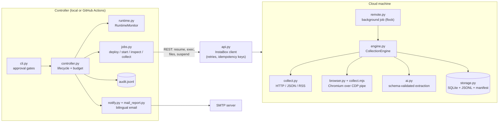
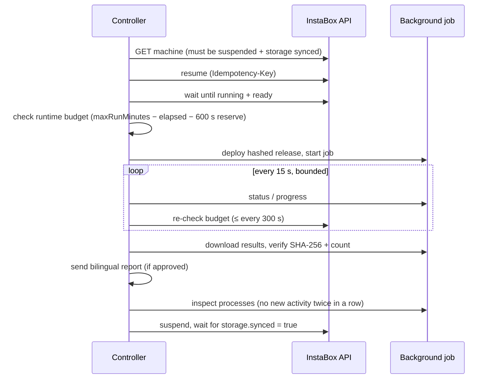

# InstaBox Agent Automation (Demo)

A safety-first orchestrator that wakes a cloud machine, runs a bounded data-collection job on it,
verifies the results, notifies people by email, and puts the machine back to sleep — with every
risky step behind an explicit approval flag and every action written to an audit log.

> **Demo video:** (coming soon)

This is a sanitized portfolio copy of a private client-style project. All real targets, accounts,
machine IDs and run evidence were removed; tests run entirely against local loopback fixtures.

---

## What it does

1. **Resumes** one pre-provisioned [InstaBox](https://instabox.sh) cloud machine through its REST API
   (it never creates, deletes or resizes machines).
2. **Deploys** this code as a hashed release bundle and starts a **background job** on the machine.
3. The job **collects** data from explicitly allowed sources (HTTP pages, JSON APIs, RSS/Atom feeds,
   and JavaScript-rendered pages via headless Chromium), normalizes records, optionally extracts
   structured fields, and stores everything in SQLite with checkpoints.
4. The controller **polls** progress inside a runtime budget, downloads and **verifies** the results
   (SHA-256 manifest + record count), and sends **bilingual (Chinese/English) email** reports.
5. It **suspends** the machine only after confirming no foreign activity, and waits until the
   platform reports storage as synced.

## Architecture



Lifecycle of one run:



## Key features

**Runtime budgets and automatic pausing**
- Budget is computed from the platform's `runStartedAt` and `maxRunMinutes`, minus a mandatory
  ≥ 600-second finishing reserve. A task that cannot fit is refused before it starts.
- Task duration is bounded (10–1800 s); polling loops have hard iteration limits.
- Detects cooldowns, run-cycle changes and limit changes; emits a 120-minute checkpoint event.
- Safe suspend: samples running processes and only suspends after two consecutive stable samples;
  never adopts a machine that is already running or mid-operation.

**Human approval gates** — nothing with cost or side effects runs by default:
`CLOUD_EXECUTION_APPROVED`, `EXCLUSIVE_MACHINE_APPROVED`, `RUNTIME_OBSERVATION_APPROVED`,
`MAIL_APPROVED`, `AI_NETWORK_APPROVED`. Each source must also declare `automation_allowed` and a
`permission_basis`; URLs with credentials, fragments or secret-looking query keys are rejected,
and redirects are treated as new, unapproved sources.

**Retries done carefully**
- REST client: bounded retries with exponential backoff for safe/idempotent calls only, honors
  `Retry-After` (capped), uses `Idempotency-Key` for lifecycle actions, and never blindly retries
  `exec` (no platform idempotency).
- Collector: per-host rate limiting, bounded retries on HTTP 429/5xx honoring `Retry-After` (≤ 60 s), conditional requests
  (`ETag` / `Last-Modified`) for incremental runs.
- Email: up to 3 attempts with backoff; duplicate state summaries are suppressed.

**Evidence and logging**
- Append-only `audit.jsonl` with explicitly selected fields only (no exception text, headers or env).
- SQLite is the source of truth; results are exported atomically to JSONL with a SHA-256 manifest.
- Disk checkpoints allow resuming an interrupted batch; URLs are de-duplicated; content changes
  are detected by hash and history is retained.
- Online SQLite backup plus a restore routine that checks integrity and never overwrites a live DB.
- Browser runs save a PNG screenshot and record per page, in a throw-away profile that is deleted.

**Bilingual email notifications**
- Chinese/English subject and body (task started, collection completed, finished, failed, …).
- `observe` mode (start + final) or `summary` mode (final only).
- Hash-verified small attachments (`results.jsonl` and an Excel-safe `results.csv`, ≤ 256 KB total)
  and a readable preview of up to 5 collected records; SMTP over implicit TLS (465) or STARTTLS. "Accepted by SMTP" is never reported as
  "received".

**Browser automation without third-party packages**
- `browser/collect.mjs` drives Chromium through the DevTools protocol over a pipe (no open debug
  port), blocks requests to any other origin, supports fill/click actions, waits for selectors and
  extracts DOM fields.

**Optional AI extraction**
- Offline JSON field mapping by default; optionally an OpenAI-compatible chat endpoint (HTTPS only,
  explicit approval) returning JSON validated against a JSON Schema. Output is marked
  `review_status: pending` — schema-valid is not treated as fact-checked.

**Public-only website research** (`intelligence.py`)
- Crawls only explicitly authorized domains, obeys `robots.txt` (longest-match rules, wildcards),
  skips admin/account/cart/order paths, stops on HTTP 429, and reports unknown business metrics as
  `null` instead of guessing.

**Tests**
- 66 unit/integration tests using mocked HTTP transports and local loopback servers.
- A 16-check end-to-end pipeline (`scripts/verify_full.py`) with a real headless Chromium.

## Run the local demo

Requirements: Python 3.11+, Node.js 22+, and Chrome/Chromium for the browser checks. No API keys,
cloud machines or email accounts are needed — everything runs on `127.0.0.1`.

```bash
python -m venv .venv && source .venv/bin/activate
python -m pip install . ruff==0.14.4

# Lint + unit tests + JS syntax check (writes output/verification/summary.json)
python scripts/verify.py

# Full pipeline on loopback fixtures: HTTP, JSON schema extraction, RSS, Retry-After,
# dynamic DOM, browser search/pagination, screenshots, incremental run, resume, dedup
python scripts/verify_full.py /usr/bin/google-chrome     # or your Chromium path

# Browser adapter only (read / search / pagination)
python scripts/verify_browser.py /usr/bin/google-chrome
```

Or just the tests:

```bash
python -m unittest discover -s tests -v
```

The cloud controller (`python -m automation.cli cloud --task-id demo --profile full`) needs an
InstaBox API key and machine ID plus the approval flags; see `.env.example`. It is not required
for the demo.

## Project layout

```
automation/        controller, REST client, runtime monitor, jobs, collector, storage, AI, mail
browser/           collect.mjs — dependency-free Chromium/CDP collector
config/            example source definitions (loopback fixtures)
fixtures/          static pages / JSON / RSS used by the tests
scripts/           local verification scripts, remote dependency prep, approved cloud acceptance
tests/             unit and integration tests (+ API contract schema)
ci/               github-actions-validate.yml — lint + tests + local pipeline, no secrets
                   (copy to .github/workflows/ to enable)
```

## Tech stack

Python 3.11+ (standard library, `httpx`, `jsonschema`), SQLite, Node.js (built-in modules only),
headless Chromium via the Chrome DevTools Protocol, SMTP, InstaBox REST API, OpenAI-compatible
chat completions (optional), GitHub Actions (CI template in `ci/`), Ruff.

---

## 中文简介

这是一个"安全优先"的云端任务编排示例：按需唤醒一台 InstaBox 云机器，在运行预算内执行有边界的数据采集任务
（HTTP、JSON、RSS，以及用无头 Chromium 采集动态页面），校验结果后发送中英双语邮件报告，确认没有其他活动后再暂停机器并等待存储同步。

主要特点：
- **预算与自动暂停**：按平台的运行开始时间和最长运行分钟数计算剩余时间，至少预留 600 秒收尾。
- **人工审批开关**：云端执行、邮件、AI 调用等默认全部关闭，需要显式设置为 `true` 才会执行。
- **谨慎重试**：只对安全请求做有上限的退避重试，遵守 `Retry-After`，生命周期操作带幂等键。
- **证据与日志**：审计日志、SQLite + JSONL + SHA-256 清单、断点续跑、去重、备份与恢复、截图。
- **测试**：66 项单元/集成测试和 16 项端到端检查，全部在本机回环地址上运行，不需要任何密钥。

本仓库是脱敏后的作品集版本，已移除真实目标网站、账号、机器 ID 和运行记录。
